# Foundry VTT Toolkit: user guide

The Foundry VTT Toolkit turns a campaign written in Google NotebookLM into a ready-to-run Foundry
VTT world: journals, NPCs, items, illustrated scenes with tokens and soundtracks, and playlists that
play YouTube music. A Gemini-powered GM Assistant inside Foundry then answers questions about the
campaign and your rulebooks, and writes new content you can import with one click.

For the exact NotebookLM entry format, see [notebooklm/format.md](notebooklm/format.md). For the
prompts that write a campaign, see [notebooklm/cyberpunk-red-prompts.md](notebooklm/cyberpunk-red-prompts.md).
Release notes are in [../CHANGELOG.md](../CHANGELOG.md).

## Contents

- [Requirements](#requirements)
- [Installing](#installing)
- [Quick start](#quick-start)
- [Features](#features)
  - [Writing the campaign in NotebookLM](#writing-the-campaign-in-notebooklm)
  - [Build campaign](#build-campaign)
  - [Campaign check](#campaign-check)
  - [Scene images](#scene-images)
  - [Scenes and scene setup](#scenes-and-scene-setup)
  - [YouTube playlists](#youtube-playlists)
  - [GM Assistant](#gm-assistant)
  - [Sources for the GM Assistant](#sources-for-the-gm-assistant)
  - [Combat: resolution and narration](#combat-resolution-and-narration)
  - [Pack campaign, and starting over](#pack-campaign-and-starting-over)
  - [Cyberpunk RED support](#cyberpunk-red-support)
  - [Macros](#macros)
- [Settings](#settings)
- [Troubleshooting](#troubleshooting)
- [Known issues and limitations](#known-issues-and-limitations)
- [Privacy: what is sent where](#privacy-what-is-sent-where)
- [For macro writers: the module API](#for-macro-writers-the-module-api)

## Requirements

- **Foundry VTT v13.**
- **A game system.** Any system works for journals, scenes, playlists, images and the GM
  Assistant. NPCs and items import as real actors and items in **Cyberpunk RED Core**, which needs
  the system's v13 build (0.93, currently on its `dev` branch).
- **A NotebookLM notebook** with your sources (rulebooks, notes, inspiration).
- **Optional free API keys, all client settings that stay in your browser:**
  - **YouTube Data API v3:** searching for and auto-picking music.
  - **Gemini:** smarter music searches, the GM Assistant and its sources. Get one at
    [aistudio.google.com](https://aistudio.google.com). Gemini scene images are the one paid
    option: they need billing on the key.
  - **A Cloudflare Worker:** better scene images (optional).

All features are GM-only.

## Installing

1. In Foundry's setup screen, choose **Add-on Modules → Install Module**, and paste the manifest
   URL:
   ```
   https://github.com/pjadga/foundry-vtt-toolkit/releases/latest/download/module.json
   ```
2. Enable **Foundry VTT Toolkit** in your world (**Game Settings → Manage Modules**).
3. Optional: add your keys in **Configure Settings → Foundry VTT Toolkit** (see [Settings](#settings)).

Two buttons appear at the top of the Journal sidebar: **Build campaign** and **GM Assistant**. **Pack
campaign** is in the Compendium sidebar, and **YouTube tracks** is in the Playlists sidebar.

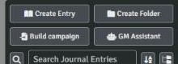

## Quick start

1. In NotebookLM, paste **Prompt 0** from the prompt kit into **Configure Chat → Custom**, then run
   Prompts 1–8. Collect the answers in one note or Google Doc and download it as `.md` or `.txt`.
2. In Foundry, click **Build campaign**, choose the file, and click **Preview**.
3. Read the campaign check, then click **Build campaign**.
4. Review the generated scene images, and click **Upload and import**.
5. When the summary appears, click **Activate** to start the first scene.

The rest of this guide explains each step.

## Features

### Writing the campaign in NotebookLM

NotebookLM writes the campaign from your sources; the toolkit only imports it. The prompt kit
([cyberpunk-red-prompts.md](notebooklm/cyberpunk-red-prompts.md)) has:

- **Prompt 0, the chat configuration (about 9,000 of NotebookLM's 10,000 characters).** It makes
  NotebookLM answer in the toolkit's `##ENTRY` format, with every type's fields and the
  consistency rules. It has three modes:
  - **Build mode (the default):** everything you ask for comes back as entries ready to import.
  - **Playtest mode:** say **start playtest** and NotebookLM runs the campaign as GM, in prose,
    so you can check it's fun. **End playtest** gives a report of what dragged, balance problems
    and gaps, each with a fix. **Apply the fixes** turns the ones you accept into entries.
  - **Campaign over:** NotebookLM asks whether to **scrap** the campaign for a new one or
    **continue** with a sequel.
- **Prompts 1–8** build the campaign in order: concept, story threads, locations, NPCs, items,
  playlists, scenes, and a consistency check.

An entry looks like this:

```
##ENTRY
type: location
name: The Overlook
district: Watson
npcs: [[Mama Rosa]]
visual: A brutalist tenement under a red sky, wind turbines on the roof
##BODY
The block's last stand against the corps...
##END
```

`[[Double brackets]]` link entries to each other. They become links in Foundry, and they drive
token placement and soundtracks.

### Build campaign

**Build campaign** (Journal sidebar) imports a NotebookLM bundle and sets everything up in one run.

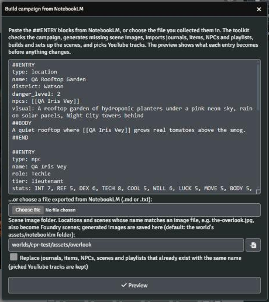

1. **Paste the entries, or choose the file** you collected them in. The importer cleans up what
   copying from NotebookLM does: code fences, citation markers like `[1, 2]`, backslash escapes,
   bold or bulleted field lines, and HTML entities.
2. **Scene image folder:** images whose file names match a location or scene become its
   background. Generated images are saved here. The default is `worlds/<world>/assets/notebooklm`.
3. **Replace…:** tick this to update documents that already exist. Without it, they are kept as
   they are. An entry with `replaces: <name>` always replaces that document.
4. **Preview** shows what each entry becomes, whether it is new, will replace an earlier import or
   is kept, which image each scene gets, and the [campaign check](#campaign-check).

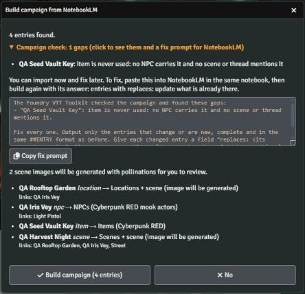

**Build campaign** then runs, in order:

1. it generates missing scene images, for you to review (see [Scene images](#scene-images));
2. it imports the journals, items, NPCs and playlists (items before NPCs, so NPCs get them);
3. it builds the scenes, numbers them in campaign order and sets them up (see [Scenes and scene
   setup](#scenes-and-scene-setup));
4. it picks YouTube tracks for playlists that have none (see [YouTube playlists](#youtube-playlists));
5. it shows a summary.

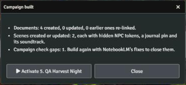

The summary lists what was created, updated and skipped, and why (click **Skipped or not found**).
**Activate** starts this build's first story scene, with its soundtrack.

What each entry type becomes:

| Entry type | In Foundry | Folder |
| --- | --- | --- |
| `journal` | Journal entry | NotebookLM / Campaign |
| `thread` | Journal entry | NotebookLM / Story Threads |
| `location` | Journal entry, plus a scene when it has an image | NotebookLM / Locations |
| `scene` | Journal entry, plus a numbered scene | NotebookLM / Scenes |
| `playlist` | Sequential playlist, filled with YouTube tracks | NotebookLM / Playlists |
| `npc` (Cyberpunk RED) | Mook actor with role, stats, skills and gear | NotebookLM / NPCs |
| `item` (Cyberpunk RED) | Weapon, armor, cyberware, gear and so on | NotebookLM / Items |

GM-only details (what an NPC is hiding, story-item notes) go into secret sections that only owners
see. Building again links earlier imports to anything new, unless you've edited them by hand.

### Campaign check

The preview checks the bundle for things that would make the campaign hard to run:

- `[[links]]` to names that have no entry and no document in the world;
- NPCs who appear in no scene, location or thread;
- items no NPC carries and no scene or thread uses;
- locations no scene or thread visits;
- scenes without `session`, `location`, `npcs_present`, `soundtrack` or `visual`, and locations
  without `visual`;
- a scene's `location:` or `soundtrack:` naming the wrong kind of entry;
- playlists without tracks.

Some things don't count as gaps:

- Rulebook gear on NPCs (`[[Heavy Pistol]]`), which is looked up in the system's compendium.
- Epilogues and prologues without a session.
- Names that already exist in the world.

You can build anyway. **Copy fix prompt** copies a prompt to paste into NotebookLM. Its answer uses
`replaces:`, so building again with it updates what is already there.

### Scene images

Locations and scenes with no matching image get one generated after you confirm the build. A scene
with no `visual:` line borrows its location's image. Generated images are saved under the entry's
name (`the-overlook.jpg`), so the next build finds them.

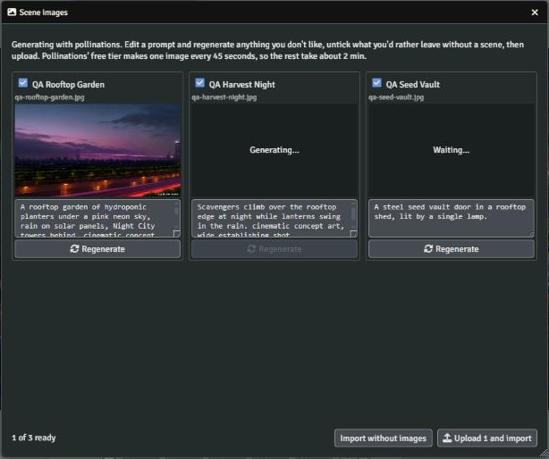

- **Edit a prompt and click Regenerate** for anything you don't like.
- **Untick a card** to leave that entry without a scene. Unticked images aren't generated.
- **Upload and import** saves the kept images and carries on. **Import without images** skips them.

The prompt is the entry's `visual:` line followed by the **Scene image style** setting. Choose the
generator in the settings. Pollinations and Cloudflare are free; Gemini is paid:

| Generator | Account | Quality | Speed |
| --- | --- | --- | --- |
| **Pollinations** (default) | None | Basic model, about 1015×580, small watermark | One image every 45 seconds; the window shows the time left |
| **Cloudflare Workers AI** | Free Cloudflare account and a Worker you deploy once ([setup](notebooklm/format.md#generated-scene-images)) | FLUX.1 schnell, no watermark, square | A few seconds each |
| **Gemini** | Your Gemini API key, **with billing** turned on | Google's *Nano Banana* models, 16:9, no visible watermark | A few seconds each; a few cents an image |

Gemini image models have no free tier. Turn on billing for the key's project in Google AI Studio
(**Billing**). Each image costs about $0.03 with the default model, and regenerations count too.
The review window and the build preview remind you of this. A key without billing gets a message
saying so instead of an image; switch to Pollinations or Cloudflare to carry on for free. The
**Gemini image model** setting chooses the model.

With **Keep generated images without review** on, the window only shows progress and the build
carries on by itself.

### Scenes and scene setup

Locations and scenes with an image become gridless Foundry scenes, sized to the image and kept out
of the player navigation bar. Story scenes are numbered and sorted in campaign order (`1. Salvage
in the Old Combat Zone` …). The order comes from their `session:`. An epilogue goes last and a
prologue first.

Each scene is also set up for play:

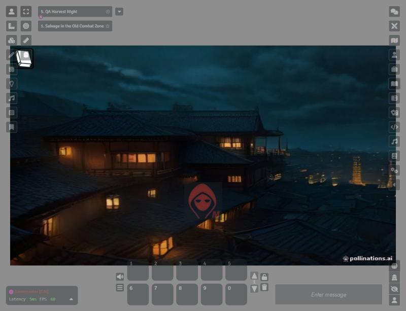

- **NPC tokens:** each NPC in `npcs_present` (a location's `npcs`) gets a **hidden** token, ready to
  reveal.
- **Journal pin:** the book pin in the top-left corner opens the scene's journal.
- **Soundtrack:** the `soundtrack:` playlist plays when you activate the scene.

Building again updates what the toolkit placed and leaves your own tokens alone. An existing scene
is updated in place only when it's being replaced, so its walls, lights and drawings survive.

### YouTube playlists

`playlist` entries become Foundry playlists whose `tracks:` lines describe the music wanted, for
example "Dark synthwave with rain, slow, 90 bpm".

- **Auto-pick:** with a YouTube key, Build campaign fills every playlist that has no tracks yet
  with the best search result for each line.
- **The picker:** **YouTube tracks** in the Playlists sidebar opens a window to search again,
  choose from the results, or paste any YouTube link.
- **With a Gemini key**, Gemini turns each description into searches and real track suggestions,
  and every one is checked on YouTube.

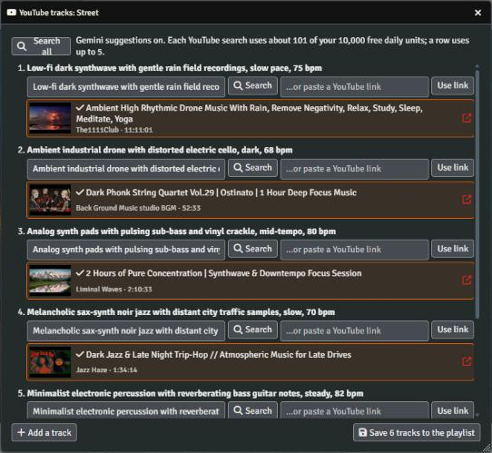

The tracks play through Foundry's normal playlist controls (play, pause, next, volume), synced
for everyone. Each client plays the video in YouTube's embedded player, in a small **Now playing**
window that YouTube's rules require to stay visible. Nothing is downloaded.

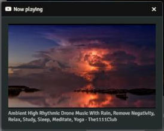

A search costs about 101 of your 10,000 free daily YouTube units. Auto-pick uses about 200 per track
line, so a campaign's three six-track playlists cost about 3,600.

### GM Assistant

**GM Assistant** (Journal sidebar) is a Gemini chat that knows the whole campaign. You can also type
`/gm <question>` in the chat box; the answer is whispered to the GMs. The window and the chat box
share one conversation.

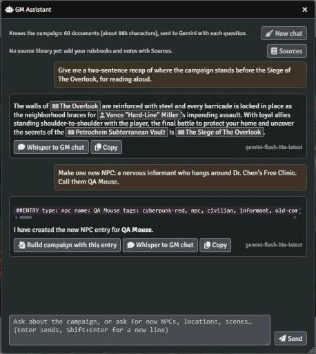

- **What it knows:** every NotebookLM journal, thread, location and scene, with their GM secrets,
  plus NPCs with their gear, items, playlists and the scene order. This is sent with each question,
  so answers reflect the world as it is now.
- **Answers** are short. Campaign names in them are links to their documents.
- **New content:** ask for an NPC, location, scene or fix and it answers in `##ENTRY` format.
  **Build campaign with this entry** opens Build campaign with it filled in, so you still see the
  preview and check first.

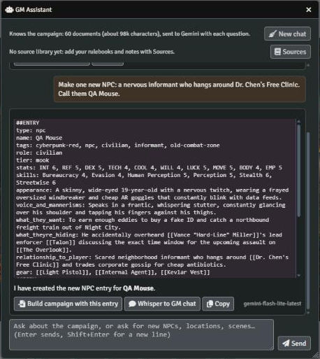

- **Whisper to GM chat** posts an answer to the chat log. **Copy** copies it. **New chat** starts
  over.
- **Pictures:** ask for one in plain words ("Draw a portrait of Rook", "Paint the docks at dawn",
  "image: the vault door"), or type a description and click **Image** next to Send. Gemini writes
  the image prompt from what the campaign says, such as an NPC's appearance or a location's
  `visual:` line. Then your **Scene image generator** draws it (Gemini, if scene images are off).
  Portraits are square, so they work as tokens too; places are 16:9.
  - **Save** uploads the picture to the Build campaign image folder. Portraits go in its
    `portraits/` subfolder.
  - **Portrait and token: <actor>** makes the picture the actor's portrait, its prototype token and
    its tokens already on scenes. **Background: <scene>** makes it the scene's background. Both
    save the picture first and ask before replacing anything.
  - These buttons appear for the actor or scene the picture shows: one named in your request,
    the prompt's subject, or one linked in the answer before. So "draw her" works right after an
    answer about her.
  - `/gm draw …` in the chat box saves the picture straight away and whispers it to the GMs with
    the same buttons.
- **Model:** `gemini-flash-lite-latest` by default, which answers in a few seconds. You can change it
  in the settings.

On its own, the assistant doesn't know your rulebooks. Give it your sources:

### Sources for the GM Assistant

NotebookLM can't share its sources, so the assistant gets its own copy through Gemini's File
Search. **Sources** in the GM Assistant window opens this dialog:

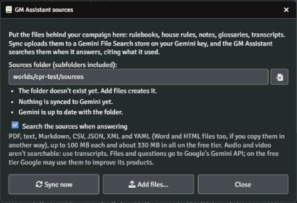

1. Put your files in the **sources folder**, `worlds/<world>/sources` by default. Subfolders are
   fine. **Add files…** opens Foundry's file browser there.
2. **Sync now** uploads new and changed files and removes deleted ones, with a progress bar. The
   dialog shows what a sync will do before you run it.
3. Every answer then searches your sources and lists the ones it used, with PDF page numbers and
   the passage it read. For rules, it answers from your rulebooks. For this campaign's own people,
   places and plot, the campaign documents take priority.

The rules for files:

- Foundry's file browser takes PDF, TXT, Markdown, CSV, JSON, XML and YAML. Word and HTML files
  work if you copy them onto the server another way.
- Each file can be up to 100 MB. The free tier holds roughly 330 MB in total.
- Audio and video can't be searched, so use transcripts instead.

**Remove from Gemini** deletes the whole store; your files in Foundry stay.

### Combat: resolution and narration

In combat, the toolkit resolves attacks by Cyberpunk RED's rules and has Gemini narrate them, so the
table gets a quick verdict and a cinematic description of every exchange.

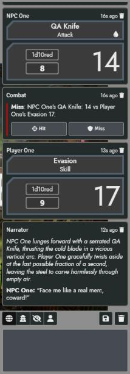

**When an attack is rolled** with a target selected (a player character attacking an NPC, or an NPC
attacking), a **Combat** card shows the result:

- **Ranged and thrown:** the DV comes from the weapon's DV table and the distance between the two
  tokens, using the autofire table for autofire. An NPC with REF 8+ dodges with Evasion instead
  when that's its better chance. A player character with REF 8+ is noted as able to dodge.
- **Melee and brawling:** a targeted NPC rolls Evasion automatically, with the system's own roll. A
  targeted player character is asked to roll Evasion, and the card resolves when they do.
- **The defender wins ties:** the attack has to beat the DV or the Evasion roll.
- **Natural rolls:** a natural 10 (exploding) or 1 (imploding) is already in the total. It also
  shows on the card and colours the narration.

What happens next depends on the result:

- **Miss:** narrated straight away: the shot goes wide, cover takes it, the target dodges.
- **Hit:** the card says *Roll damage*. Narration waits for the damage roll, which confirms the hit.
- **GM control:** **Hit** and **Miss** on the card override the result, for an ambush, cover or
  anything else the rules didn't see. Rolling damage after a miss also counts as you saying it hit.
  Turning a miss into a hit removes the miss's narration, so players don't read both.
  When the toolkit can't work out the range, for example when the tokens are on a scene you aren't
  viewing, the card asks you to choose.

**When damage is rolled**, it's matched to its attack; with ROF 2, two damage rolls match two hits
in order. With **Apply damage on a hit** set to *NPCs only* (the default) or *everyone*, it's applied
through the system's own Apply Damage, so armor SP, ablation and the Critical Injury bonus are
handled by the system. The damage card then says it was applied, so nobody applies it twice.

The hit is then narrated from what the damage did:

- the damage and where it landed (the head for aimed shots);
- a Critical Injury, from two or more 6s;
- the armor that took it, by name, and how much it stopped (melee halves SP);
- how hurt the target is now: lightly, seriously or mortally wounded;
- the NPC's reaction to the pain.

**The narration** knows:

- the attack card;
- how the attack was made: a single shot, autofire, an aimed shot, thrown or melee;
- a natural 10 (critical success) or 1 (fumble) on the attack die;
- whether the target can dodge a ranged attack (only REF 8 or more can, so others never sidestep
  bullets in the narration);
- the round and whose turn it is;
- the NPCs' public notes, such as appearance and voice;
- the last 20 public chat messages;
- the most recent narration, so it doesn't repeat itself.

An NPC never repeats a line it has said before. If a narration copies earlier wording anyway, the
toolkit asks Gemini again. GM-only secrets and whispered messages are never included, because
players read the result.

Set **Combat narration** to *Show me first* to read each narration before players do. Suppressive
fire, and attacks in other game systems, get attempt narration only, with no resolution.

### Pack campaign, and starting over

**Pack campaign** (Compendium sidebar) packs the whole campaign into one Foundry **Adventure** in
the world compendium *NotebookLM Campaigns*. That covers every NotebookLM document, anything you
added to its folders, and the folders themselves. Packing again under the same name replaces that
adventure.

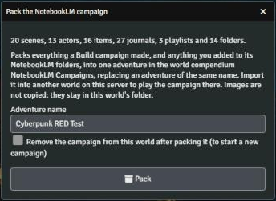

- **To play it in another world:** move the compendium there and use **Import Adventure**. Links,
  tokens and pins survive. Images aren't copied: they stay in this world's folder, so the other
  world must be on the same server.
- **To scrap the campaign and start a new one:** tick *Remove the campaign from this world after
  packing it*. The toolkit checks the adventure holds everything, asks you to confirm, and then
  deletes the campaign from the world. **Import Adventure** brings it back.
- **To continue with a sequel:** don't remove anything. Tell NotebookLM **campaign over** and
  choose *continue*. It writes an *Aftermath* journal, then builds the sequel. The sequel reuses
  your NPCs and places and numbers its sessions on from the old campaign's, so its scenes are
  numbered after the old ones.

### Cyberpunk RED support

In a Cyberpunk RED world:

- **Items** are built on the closest core compendium item, so weapon skills, DV tables and ammo
  stay valid. The entry's damage, rate of fire, SP, Humanity Loss and price are applied on top.
- **NPCs** are mook actors with their role and rank, stats, skills and HP. Their gear is matched
  to the core compendiums and equipped or installed, and Humanity and EMP are reduced for their
  cyberware.
- **Secret sections** on Cyberpunk RED sheets are shown to owners. The system's own sheets hide
  them from everyone, GM included.

Field details are in [format.md](notebooklm/format.md#cyberpunk-red-items).

### Macros

The `macros/` folder has standalone script macros. They're all in the **Custom-Macros** compendium,
which comes in its own small module, **Foundry VTT Toolkit: Custom Macros**: install it from the
manifest `https://github.com/pjadga/foundry-vtt-toolkit/releases/latest/download/macros-module.json`
and enable it in the world. It works on Foundry v12 and v13, with or without the main toolkit. In the
Compendium sidebar the macros are in folders by system: drag one to your hotbar, or right-click it
and import it. Players can open the compendium too. Without the module, create a Script macro in
Foundry and paste the file's contents into it.

| Macro | System | What it does |
| --- | --- | --- |
| Import from NotebookLM | any | Opens Build campaign (needs the module) |
| Toggle Selected Tokens Hidden | any (GM) | Flips the hidden state of the selected tokens |
| Toggle Acted | any (v12, v13) | Tints your selected tokens red to show they've acted this turn; click again to take it off. With nothing selected, your assigned character's token |
| Token Info | any | Whispers you a summary of each selected token's actor |
| Whisper Roll to GM | any | Asks for a formula, rolls it, and whispers the result to the GM |
| Party Passive Perception | dnd5e | Whispers each player character's passive Perception to the GM |
| Inspect Actor Data | cyberpunk-red-core, sw25 | Logs the selected actor's data to the console (F12), for writing macros |

## Settings

These are in **Configure Settings → Foundry VTT Toolkit**. All of them are stored only in your
browser (client settings), and none reach players.

| Setting | Default | What it does |
| --- | --- | --- |
| YouTube Data API key (GM) | none | Searches and auto-picks YouTube tracks |
| Pick YouTube tracks during import | on | Fills playlists that have no tracks after a build |
| Gemini API key (GM, optional) | none | Smarter music searches, the GM Assistant, and sources |
| GM Assistant model | `gemini-flash-lite-latest` | The model the assistant and combat narration use; others get 30 s before the lite model answers |
| Combat narration (GM) | Post for everyone | Narrate attacks: post for everyone, show the GM first, or off |
| Resolve attacks automatically (Cyberpunk RED) | on | Hit or miss from range DV or Evasion, with a Combat card |
| Apply damage on a hit (Cyberpunk RED) | To NPCs only | Apply confirmed hits with the system's Apply Damage: to NPCs, to everyone, or off |
| Gemini model | `gemini-flash-lite-latest` | The model for music search suggestions |
| Scene image generator (GM) | Pollinations | Pollinations, Cloudflare Workers AI, Gemini (needs billing), or off. The GM Assistant draws with it too |
| Gemini image model | `gemini-3.1-flash-lite-image` | The model for Gemini images (Nano Banana 2 Lite, the fastest and cheapest). `gemini-nano-banana-2.1` and `gemini-3-pro-image` draw more carefully and cost more |
| Scene image style | cinematic concept art… | Added to every image prompt |
| Keep generated images without review | off | Uploads every generated image without asking |
| Cloudflare Worker URL / token | none | Your Worker, for the Cloudflare generator |
| Debug logging | off | Logs the toolkit's activity to the console |

The image folder, sources folder and *search the sources* choice are remembered from their dialogs.

## Troubleshooting

| Problem | Cause and fix |
| --- | --- |
| No **Build campaign** or **GM Assistant** button | These are GM-only, in the Journal sidebar. Check the module is enabled in this world. |
| "0 entries found" or "the line breaks are missing" | Copy NotebookLM's answer from inside its code block, or export the note as a file and choose it. |
| A field is ignored | Use the field names from the prompt kit. Field lines go before `##BODY`, one `key: value` per line. |
| A link shows as bold text instead of a link | Nothing has that exact name yet. A later build that adds it links it. Otherwise, fix the spelling so both entries match. |
| A scene wasn't created ("no image") | No image matched the entry's name, generation was off, or you unticked it. Add an image named after the entry, or set an `image:` line, and build again. |
| "Free limit reached" or images failing on Pollinations | Pollinations' free tier makes one image every 45 seconds per internet connection. The toolkit waits and retries; if images still fail, click **Regenerate** later. Other Pollinations use on the same network counts too. Cloudflare avoids the wait. |
| "Could not read the scene image folder" | The folder doesn't exist. Pick another, or leave the field empty for the default. |
| An NPC is missing some gear | The gear's name doesn't match the system's compendium. The NPC's GM notes list "gear not in the compendium". Use the rulebook name, or add the item as an `item` entry. |
| No YouTube results, or "quota" errors | Check the YouTube key (in settings, YouTube Data API v3 enabled). The free quota is 10,000 units a day and resets daily. Auto-pick stops cleanly when it runs out. |
| Music doesn't play | Browsers only play sound after you click the page, so click anywhere in Foundry. If you closed **Now playing**, music stays off on your screen until the next track. For "the owner may not allow embedding", pick another track. |
| "Gemini image models need billing" | Image models have no free tier. Turn on billing for the key's project in Google AI Studio, or choose Pollinations or Cloudflare as the scene image generator. |
| "Gemini didn't answer" or a slow assistant | Keep the model on `gemini-flash-lite-latest`. Busy models are skipped for 10 minutes. The free tier allows only a few requests a minute. |
| "Add your Gemini API key" | Add a key from [aistudio.google.com](https://aistudio.google.com) in the settings. |
| A source file "can't be searched" | Convert it to PDF, text or Markdown. Use transcripts for audio and video, and split files over 100 MB. |
| A source file "not synced" | Click **Sync now** again. The list after a sync shows each failure and why. |
| "The adventure doesn't hold everything" | Packing didn't capture every document, so nothing was removed. Pack again and check the compendium. |
| No Combat card or narration after an attack | Check that a target was selected when rolling: a player character's attack counts only when it targets an NPC. A GM with a Gemini key must be logged in, because their browser does the work. The settings must be on. |
| The range DV is wrong | The DV comes from the distance between the tokens, using the scene's grid scale. Gridless scenes imported from NotebookLM use 2 m per 100 pixels. Fix the token positions or the scene's grid, or use the card's **Hit** and **Miss** buttons. |
| A damage roll wasn't narrated | Damage is matched to the attacker's last open attack (within the last 40 messages), or to the targets on the damage card. If neither exists, it isn't narrated. |
| Secret sections are missing on a sheet | Secrets show only to the document's owners, the GM included. Players see them only on their own characters. |

For anything else, turn on **Debug logging**, then check the browser console (F12) for lines
starting `foundry-vtt-toolkit |`.

## Known issues and limitations

**NotebookLM:**

- There's no NotebookLM API. You copy or export NotebookLM's answers by hand. For the same
  reason, the assistant can't use your notebook's sources directly; sync copies of them instead.
- Building a second campaign in a world that already holds one has side effects: scene numbering
  runs across every imported story scene in the world, so the first campaign's scenes are
  renumbered and interleaved with the new ones by session; the track picker also fills any
  imported playlist that has no tracks, including an empty one from the first campaign; and an entry
  with the same name as an existing document (a "Campaign Overview", a "Street" playlist) is
  skipped, not added. Rename the second campaign's overview and playlists before building, and check
  the scene names afterwards.

**Building:**

- Story-scene numbering covers every NotebookLM story scene in the world, so two separate
  campaigns in one world share it. Pack and clear the old campaign first, or build a sequel with
  sessions that follow on.
- Building again with a changed NPC or item replaces the whole document, so changes you made by
  hand on its sheet are lost. Journals you edited by hand aren't re-linked.

**Images:**

- Pollinations' free model follows prompts loosely and adds a small watermark. Cloudflare images
  are square, so they are cropped differently on wide scenes.
- Gemini images need billing on the API key: free-tier keys get no image quota (October 2026).
- A picture the GM Assistant draws stays only in the window until you save or use it. A reload or
  **New chat** discards it.

**YouTube:**

- Auto-pick fills every NotebookLM playlist without tracks, not just the ones in the current
  build. Picks match descriptions loosely, and can be full albums or tracks with vocals; swap them
  in the picker.
- Some videos don't allow embedding. Browsers block sound until the first click.

**GM Assistant:**

- The conversation isn't saved: a reload or **New chat** clears it. For a very large world the
  campaign is cut to fit (12,000 characters per document, 400,000 in all); the window says when
  documents are left out.
- The full Flash model can hang for minutes on the free tier, which is why the lite model is the
  default.

**Combat:**

- Resolution follows Cyberpunk RED's core rules and leaves the rest to you. Cover, ambushes,
  situational modifiers, suppressive fire and autofire multipliers aren't modelled; use the
  **Hit** and **Miss** buttons for them. Range is measured between token centres.
- Narration is written in the active GM's browser, about a second or two after each roll. On
  Gemini's free tier, a very fast combat can hit its per-minute limit, and the failure shows as a
  warning.

**Sources and packing:**

- The free tier's File Search store holds about 330 MB of files. Foundry's file browser won't
  upload Word or HTML files.
- **Pack campaign** doesn't copy images.

**System support:**

- Cyberpunk RED's v13 support is an unreleased development build of the system. In other systems,
  `npc` and `item` entries are skipped (the preview says "not supported yet"); everything else
  works.
- The Sword World 2.5 and Cyberpunk RED macros only log actor data so far.

## Privacy: what is sent where

| Feature | Sent to | What |
| --- | --- | --- |
| Scene images | Pollinations, your Cloudflare Worker, or Google (Gemini API) | The image prompt |
| YouTube search | Google (YouTube Data API) | Search words |
| Music suggestions | Google (Gemini API) | Track descriptions and playlist moods |
| GM Assistant | Google (Gemini API) | The campaign, GM secrets included, and your questions, with each question. A picture's prompt then goes to the scene image generator |
| Combat narration | Google (Gemini API) | The attack and damage cards, the NPCs' public notes, and the last 20 public chat messages |
| Sources | Google (Gemini File Search) | The files you sync, kept until you remove them |

On Gemini's free tier, Google may use what you send to improve its products. Google says NotebookLM
doesn't use your data this way. Enabling billing on your Gemini key switches it to paid-tier terms.

## For macro writers: the module API

`game.modules.get("foundry-vtt-toolkit").api` has:

| Call | Does |
| --- | --- |
| `importer.open({ text })` | Opens Build campaign, optionally with entries filled in |
| `importer.importEntries(entries, { overwrite, images })` | Imports parsed entries without the dialogs |
| `importer.parseBundle(text)` | Parses `##ENTRY` text into `{ entries, warnings }` |
| `importer.pack()`, `importer.packAdventure(name)`, `importer.clearCampaign()` | Pack campaign, and clearing the world |
| `importer.registerType(type, handler)` | Adds an entry type, as the Cyberpunk RED support does |
| `youtube.pick(playlist)`, `youtube.choose()`, `youtube.autoPick(playlists)` | The YouTube picker, and auto-picking |
| `assistant.open()`, `assistant.ask(question)` | The GM Assistant |
| `assistant.sources()`, `assistant.syncSources()` | The Sources dialog, and syncing |
